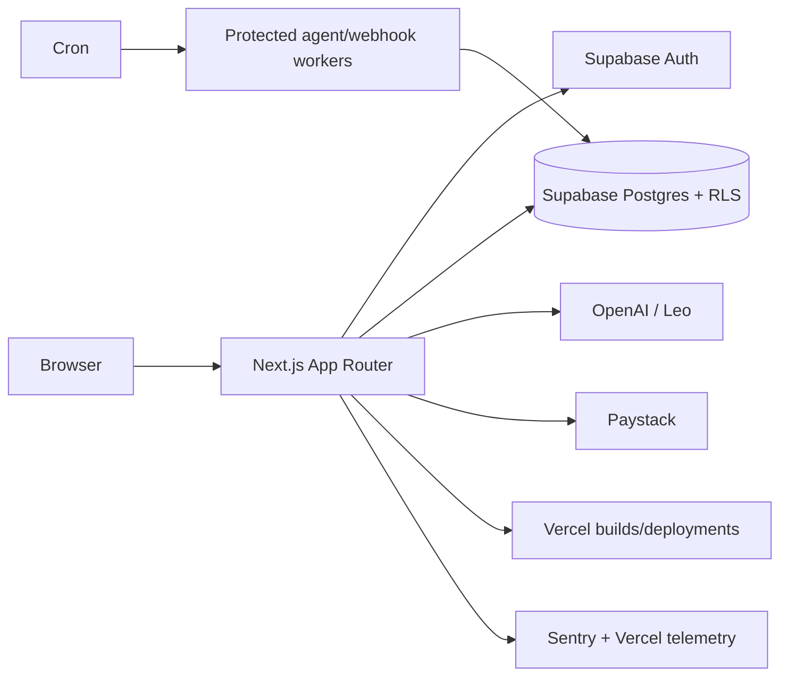

# LeonardX architecture guide

Service-role handlers must reapply user/organization predicates. Payment/webhook state is server trusted. Agent jobs are durable only when the protected worker and scheduler are enabled. See [`LEONARDX_SCALABILITY_AUDIT.md`](./LEONARDX_SCALABILITY_AUDIT.md).
