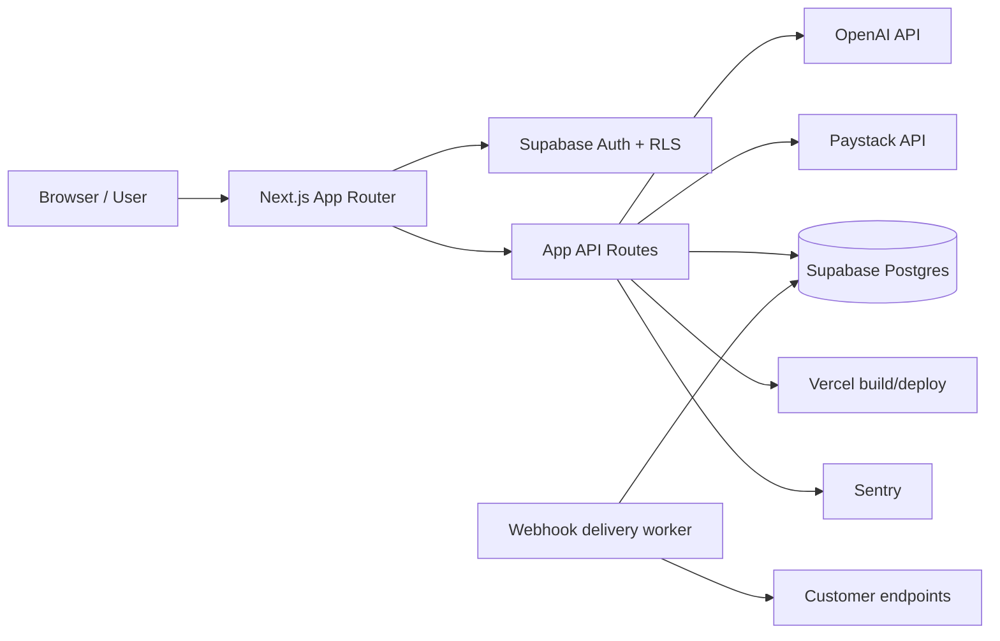

# LeonardX Scalability Audit

Date: 2026-10-12

## Status summary

- VERIFIED WITH EVIDENCE: The repository is a Next.js app with a Supabase-backed auth/data layer, OpenAI-backed AI routes, and server-side Paystack integration. The app successfully passes `npm run lint` and `npm run build` in this environment.
- PARTIAL: Production capacity, queueing, multi-instance durability, and DB/provider stress testing remain partially verified due missing external credentials and staging infrastructure.
- BLOCKED: Live DB migration execution and real provider-level load tests require valid Supabase/Postgres and external service credentials.
- NOT IMPLEMENTED: Durable horizontal scaling, distributed queue/worker topology, real multi-instance soak tests, and production load benchmarks beyond this local environment.

## Repository baseline and evidence

- App framework: [package.json](package.json)
- Core app routes: [app](app)
- Auth and admin access: [lib/auth.ts](lib/auth.ts)
- OpenAI gateway: [lib/openai.ts](lib/openai.ts)
- Payments: [lib/payments.ts](lib/payments.ts), [app/api/payment/webhook/route.ts](app/api/payment/webhook/route.ts)
- Webhooks/cron: [app/api/internal/webhooks/worker/route.ts](app/api/internal/webhooks/worker/route.ts), [lib/webhooks.ts](lib/webhooks.ts)
- Database/docs: [supabase](supabase)
- Next.js config: [next.config.js](next.config.js)

Evidence commands run:

- `cd /workspaces/LEOOS && npm run lint` -> success
- `cd /workspaces/LEOOS && npm run build` -> success

## Architecture snapshot

## Dependency map

- Frontend: Next.js 16 app router, React 19, Tailwind, lucide icons.
- Auth and user data: Supabase SSR client and service-role client.
- AI orchestration: OpenAI SDK on server side via [lib/openai.ts](lib/openai.ts).
- Payment path: Paystack verify/init + webhook verification in [lib/payments.ts](lib/payments.ts) and [app/api/payment/webhook/route.ts](app/api/payment/webhook/route.ts).
- Queue/retry worker: [app/api/internal/webhooks/worker/route.ts](app/api/internal/webhooks/worker/route.ts) polls queued `webhook_deliveries` rows.
- Observability: Sentry integration and monitoring helpers in [lib/monitoring.ts](lib/monitoring.ts) and [lib/monitoring-utils.ts](lib/monitoring-utils.ts).
- Deployment workflow: project/build/deploy routes under [app/api/build-deploy/route.ts](app/api/build-deploy/route.ts) and related routes.

## Request/data-flow map

1. Public or authenticated page loads in Next.js.
2. Browser uses Supabase JS client for auth/session state.
3. Authenticated requests pass bearer tokens to server routes.
4. Server routes use `adminSupabase()` with service-role key for protected reads/writes.
5. AI features call OpenAI; provider failures are handled with user-facing errors and budget-aware checks.
6. Payments use Paystack init + verify + webhook path for trusted finalization.
7. Webhook delivery jobs are queued in Postgres and processed through cron/worker route.
8. Monitoring data is sent to Sentry when configured.

## Baseline risk register

| Priority | Risk | Evidence | Impact | Current status |
|---|---|---|---|---|
| P0 | External provider and DB credentials not configured in this environment | Repo contains required env vars but no live staging config | Blocks real DB migration / provider verification | BLOCKED |
| P0 | Durable queue/worker model is not yet a true distributed, recoverable system | Worker is a cron-triggered poller, not a managed queue | Jobs can be delayed or lost if process/state mismatch occurs | PARTIAL |
| P1 | Multi-instance behavior not verified | No staging or multiple-instance tests executed | Race conditions possible in auth, credits, job state | PARTIAL |
| P1 | AI cost and concurrency controls are not fully enforced at scale | OpenAI calls exist but no exhaustive load/cost model in staging | Cost spikes and rate-limit failures are possible | PARTIAL |
| P1 | Payment and credit idempotency needs audit under concurrency | Payment verification logic exists but real sandbox replay not executed | Duplicate charging or credit granting risk | PARTIAL |
| P2 | Public static page performance and auth latency not measured under load | Only build and lint validated here | True p50/p95/p99 under user load remains unknown | PARTIAL |
| P3 | Some UI routes still use client-side redirects and raw image tags in older pages | lint no longer reports these warnings after the fix | Not a critical reliability issue but should be kept clean | VERIFIED WITH EVIDENCE |

## Verified conclusions

- The codebase is a real Next.js + Supabase + OpenAI + Paystack app, not a stub.
- The repository compiles and passes lint/tests in the local container.
- The main production risk is not a compile break; it is external service readiness, staging validation, and load/capacity evidence.
- Horizontal scaling, queue durability, and provider budgets should be treated as architecture items requiring environment-backed verification.

## Next highest-priority actions

1. Validate DB migration execution in a real Supabase environment.
2. Run targeted load and concurrency tests on auth, AI, and payment flows in staging.
3. Add explicit queue and worker metrics plus alert thresholds before calling the system ready for high traffic.
